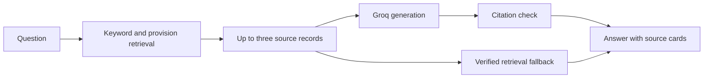

# Citation-Grounded Legal RAG

[Open the live demo](https://citation-grounded-legal-rag.vercel.app/)

This is a small legal-research prototype for selected Indian consumer-law sources. A question is matched against a curated source set before an answer is generated. The page always shows the records used and links back to the primary source.

The project is intentionally narrow. It is a demonstration of retrieval, evidence handling, safe fallback behaviour, and evaluation, not a general-purpose legal assistant.

## Interface

Desktop search view:


Mobile search view:


## What is in scope

The current corpus contains 41 curated records from four source families:

- Consumer Protection Act, 2019: definitions, complaints, CCPA powers, remedies, appeals, and limitation.
- Consumer Protection (E-Commerce) Rules, 2020: platform disclosures, seller duties, refunds, complaint handling, and pre-purchase information.
- Guidelines for Prevention of Misleading Advertisements and Endorsements, 2022.
- Guidelines for Prevention and Regulation of Dark Patterns, 2023.

The app does not search judgments yet. Judgment search is held back until Consumer Disputes material has been filtered, source-linked, and reviewed.

## Request path



If generation is unavailable, incomplete, or returns invalid citations, the app shows a retrieval fallback from the same evidence instead of inventing an answer.

## Evaluation

The evaluation notes are kept in [docs/evaluation](docs/evaluation/README.md).

- The known 50-question regression suite recorded 45 core passes after Stage 3. See [Run 3](docs/evaluation/run-3-2026-10-29.md).
- The frozen 20-question unseen set recorded 20 core passes after the Stage 4 retrieval fixes. See the [Stage 4 re-run](docs/evaluation/unseen-set-1-stage4-results-2026-10-31.md).

These are small, source-scoped checks. They are not a claim of overall legal accuracy, production readiness, or legal advice. The Stage 4 report also records eight responses that displayed nonessential extra source cards.

## Run locally

Requires Node.js 20+ and Python for the small case-curation test suite.

```powershell
cd B:\Rag\consumer-law-research
python -m http.server 8080
```

Open `http://localhost:8080`. A plain static server has no `/api/ask` function, so the interface uses its local, source-backed fallback.

Run the checks with:

```powershell
npm test
python -m unittest discover -s tests -v
```

## Deploy

The site is deployed on Vercel. Set `GROQ_API_KEY` in Vercel Environment Variables to enable generated answers; without it, the source-backed fallback still works. Deployment details and the security notes are in [docs/deployment.md](docs/deployment.md).

## Source material

- [Consumer Protection Act, 2019](https://www.indiacode.nic.in/bitstream/123456789/15256/1/a2019-35.pdf)
- [Consumer Protection (E-Commerce) Rules, 2020](https://consumeraffairs.nic.in/sites/default/files/E%20commerce%20rules_0.pdf)
- [Misleading Advertisements and Endorsements Guidelines, 2022](https://consumeraffairs.nic.in/latestnews/guidelines-prevention-misleading-advertisements-and-endorsements-misleading)
- [Dark Patterns Guidelines, 2023](https://consumeraffairs.nic.in/sites/default/files/The%20Guidelines%20for%20Prevention%20and%20Regulation%20of%20Dark%20Patterns%2C%202023.pdf)

## Limits

- This is an educational research tool, not legal advice.
- Only the listed source families are searchable.
- Generated answers depend on Groq availability and request limits; retrieval fallback remains available.
- Users should read the linked primary source before acting on a result.
