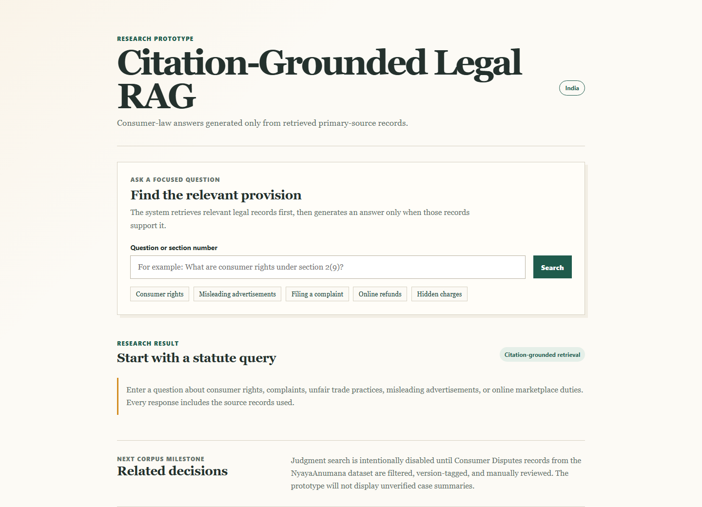
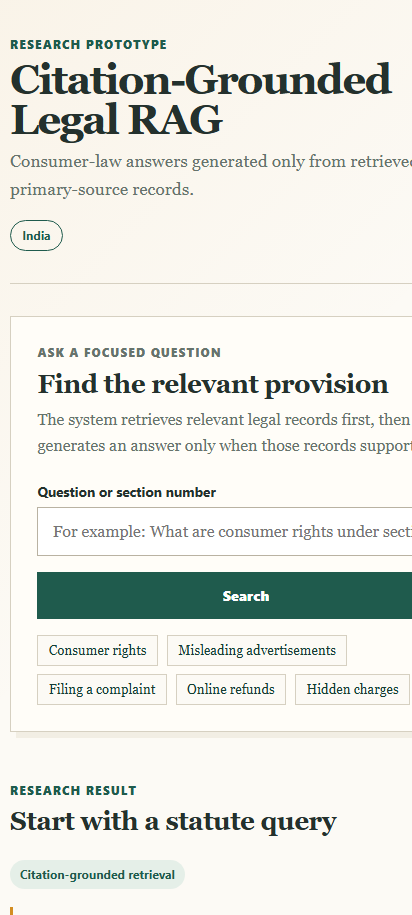
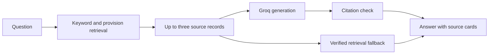

# Citation-Grounded Legal RAG

[Open the live demo](https://citation-grounded-legal-rag.vercel.app/)

This is a small legal-research prototype for selected Indian consumer-law sources. A question is matched against a curated source set before an answer is generated. The page always shows the records used and links back to the primary source.

The project is intentionally narrow. It is a demonstration of retrieval, evidence handling, safe fallback behaviour, and evaluation, not a general-purpose legal assistant.

## Interface

Desktop search view:



Mobile search view:



## What is in scope

The current corpus contains 90 source-checked records covering:

- Consumer Protection Act, 2019: definitions, complaints, CCPA powers, remedies, appeals, and limitation.
- Consumer Protection (E-Commerce) Rules, 2020: platform disclosures, seller duties, refunds, complaint handling, and pre-purchase information.
- Guidelines for Prevention of Misleading Advertisements and Endorsements, 2022.
- Guidelines for Prevention and Regulation of Dark Patterns, 2023.
- Consumer Commission jurisdiction rules, 2021: ordinary complaint limits based on consideration paid.
- Official NCH grievance guidance and e-Jagriti filing and help resources.

The app does not search judgments yet. Judgment search is held back until Consumer Disputes material has been filtered, source-linked, and reviewed.

Records now live in versioned JSON, with official quotations, PDF page references,
source hashes, and effective dates. Six replacement versions of existing
e-commerce records are kept separate until 1 January 2027. See [source data](docs/source-data.md)
for the format and checks. This is not a complete consolidated edition of these laws.

The six issue guides cover refunds, unsafe products, misleading ads, hidden charges,
seller disputes and complaint filing. They show selected provisions and official
routes without asking the model to invent a filing procedure. Preparation notes are
practical suggestions, not official filing checklists.

## Request path



If generation is unavailable, incomplete, or returns invalid citations, the app shows a retrieval fallback from the same evidence instead of inventing an answer.

## Evaluation

The evaluation notes are kept in [docs/evaluation](docs/evaluation/README.md).

The [2 November retrieval comparison](docs/evaluation/retrieval-comparison-2026-11-02.md)
uses the expanded 90-record corpus. Of 40 supported questions, the current retriever
found all labelled evidence in its top three for 30; BM25 for 35; dense and hybrid
for 37 each. The current retriever abstained on only 2 of 10 unsupported questions;
the comparators abstained on none. These agent-authored questions are not an
independent human holdout or an answer-accuracy score. Production retrieval is
unchanged while abstention and independent evaluation remain unresolved.

- The known 50-question regression suite recorded 45 core passes after Stage 3. See [Run 3](docs/evaluation/run-3-2026-10-29.md).
- The frozen 20-question unseen set recorded 20 core passes after the Stage 4 retrieval fixes. See the [Stage 4 re-run](docs/evaluation/unseen-set-1-stage4-results-2026-10-31.md).

These are small, source-scoped checks. They are not a claim of overall legal accuracy, production readiness, or legal advice. The Stage 4 report also records eight responses that displayed nonessential extra source cards.

Those reports predate the versioned-corpus migration. The updated quotations need
a fresh answer evaluation before reusing the same accuracy figures.

The expanded corpus also has 38 additional retrieval regression queries. CI checks
the frozen 50-question keyword/BM25 rankings without downloading models. The
embedding experiment is optional and local; it adds no dependency to the live app.

## Run locally

Requires Node.js 20.18.3+ (22+ recommended) and Python 3.10+ for data checks.

```powershell
cd B:\Rag\consumer-law-research
python -m http.server 8080
```

Open `http://localhost:8080`. A plain static server has no `/api/ask` function, so the interface uses its local, source-backed fallback.

Run the checks with:

```powershell
python -m pip install -r requirements-dev.txt
python scripts/validate_corpus.py
npm test
python -m unittest discover -s tests -v
```

For the optional browser checks, keep the local server running and open
`http://localhost:8080/tests/browser-smoke.html`. It checks the issue guides,
official routes, responsive layout, offline fallback and overlapping search requests.

## Deploy

The site is deployed on Vercel. Set `GROQ_API_KEY` in Vercel Environment Variables to enable generated answers; without it, the source-backed fallback still works. Deployment details and the security notes are in [docs/deployment.md](docs/deployment.md).

## Source material

- [Consumer Protection Act, 2019](https://www.indiacode.nic.in/bitstream/123456789/15256/1/a2019-35.pdf)
- [Consumer Protection (E-Commerce) Rules, 2020](https://consumeraffairs.nic.in/sites/default/files/E%20commerce%20rules_0.pdf)
- [Misleading Advertisements and Endorsements Guidelines, 2022](https://consumeraffairs.nic.in/latestnews/guidelines-prevention-misleading-advertisements-and-endorsements-misleading)
- [Dark Patterns Guidelines, 2023](https://consumeraffairs.nic.in/sites/default/files/The%20Guidelines%20for%20Prevention%20and%20Regulation%20of%20Dark%20Patterns%2C%202023.pdf)
- [Commission jurisdiction rules, 2021](https://consumeraffairs.gov.in/public/upload/files/232278_1732705029.pdf)
- [National Consumer Helpline](https://consumerhelpline.gov.in/public/)
- [e-Jagriti filing guides](https://e-jagriti.gov.in/help-docs)

## Limits

- This is an educational research tool, not legal advice.
- Only the listed source families are searchable.
- Generated answers depend on Groq availability and request limits; retrieval fallback remains available.
- Users should read the linked primary source before acting on a result.
